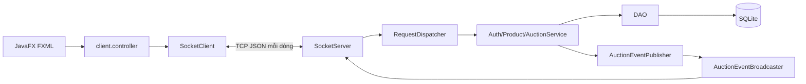
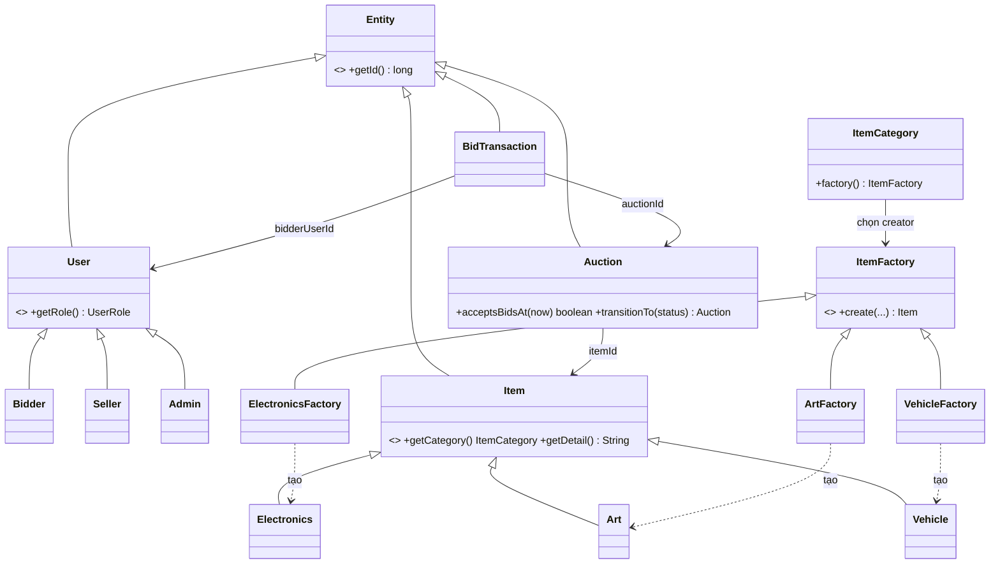
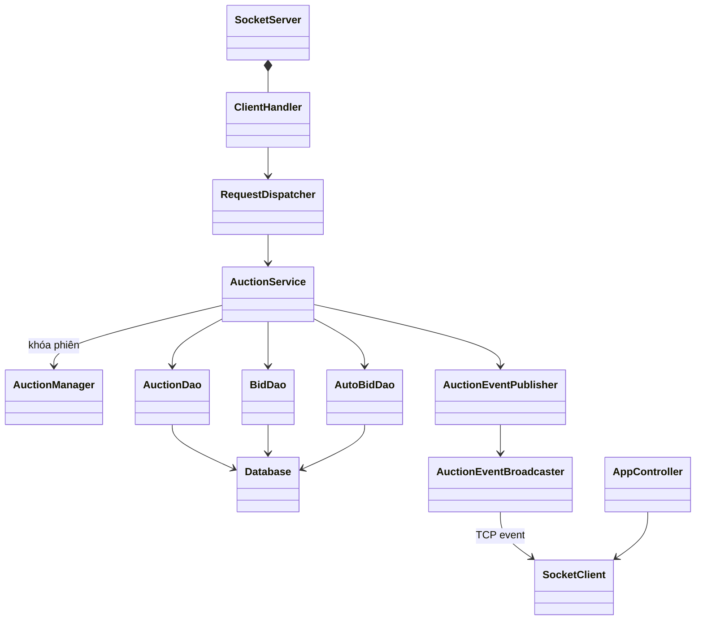

# Kiến trúc và các lớp chính

**Mục đích:** Thấy các phần của ứng dụng liên hệ thế nào, rồi hiểu OOP và mẫu thiết kế trong file thật. Cần biết class, method, package từ [JAVA_BASICS.md](JAVA_BASICS.md). Khi đọc, mở song song mã nguồn trong VS Code.

## Bức tranh chung

Ứng dụng có ba **module** Maven. `common` là phần dùng chung: model, DTO và giao thức. `client` là ứng dụng JavaFX mà người dùng mở. `server` nhận kết nối, quyết định quyền/giá và dùng SQLite. `client` và `server` đều phụ thuộc `common`; `client` không phụ thuộc `server` hoặc JDBC.

**Client–Server** nghĩa là giao diện gửi yêu cầu đến chương trình phục vụ ở nơi khác, rồi nhận câu trả lời. Ví dụ client gửi `PLACE_BID`, server kiểm tra và trả `AuctionDto`; chỉ server biết giá chính thức. Hiện `ServerMain` bind `127.0.0.1:5555`, tức chỉ cùng máy kết nối theo cấu hình mặc định. Đây là ứng dụng desktop qua TCP, chưa có trang web hoặc TLS. Xem [giao thức](API_PROTOCOL.md).

**MVC** là cách tách màn hình (**View**: `client/src/main/resources/view/*.fxml`), nơi nhận thao tác (**Controller**: `client.controller`) và dữ liệu/logic (**Model**: DTO từ `common`, service trên server). `AppController` điều hướng màn và giữ token. `SocketClient` chuyển request/event qua mạng. `DetailController` không tự tính người thắng; nó hiển thị kết quả từ server.

## Sơ đồ lớp nghiệp vụ

Các file trên ở `common/src/main/java/com/btl/auction/common/model`. `Entity` có ID dùng chung. `User` có vai trò, `Item` có danh mục và giá khởi điểm. `Auction` có giờ bắt đầu/kết thúc, giá hiện tại, người dẫn đầu và trạng thái; `BidTransaction` là một lần đặt giá. Mũi tên ID biểu diễn quan hệ dữ liệu, không có nghĩa object chứa cả object kia.

**Đóng gói**: field trong model được giữ bên trong, constructor/method kiểm tra tính hợp lệ. **Kế thừa**: `Bidder`, `Seller`, `Admin` dùng phần chung của `User`; ba loại item dùng phần chung của `Item`. **Đa hình**: gọi `getRole()` hay `getCategory()` qua kiểu cha nhưng nhận kết quả của lớp con. **Trừu tượng**: `Entity`, `User`, `Item` giữ cấu trúc chung và không tạo trực tiếp. Ví dụ đơn giản: `ItemCategory.ELECTRONICS.factory().create(...)` trả về `Electronics`, nhưng nơi gọi vẫn có thể giữ biến kiểu `ItemFactory` và `Item`.

## Những mẫu thiết kế trong code

**Singleton** là một object dùng chung trong một tiến trình. `server/src/main/java/com/btl/auction/server/service/AuctionManager.java` có `getInstance()` và các `ReentrantLock` theo ID phiên. Một chỗ quản lý khóa giúp các bid cùng phiên vào lần lượt. Singleton không giữ giá chính thức; SQLite và `AuctionService` quyết định giá.

**Factory Method**: `ItemFactory` là creator trừu tượng, khai báo method `create`. `ElectronicsFactory`, `ArtFactory`, `VehicleFactory` ghi đè method đó để tạo loại `Item` tương ứng. `ItemCategory.factory()` đưa caller đến creator phù hợp, nên `ProductService` không cần `switch` hay gọi constructor của từng loại. Khi thêm danh mục, cần thêm loại `Item`, creator mới và hằng enum tương ứng; không cần sửa `ItemFactory` hoặc `ProductService`.

**Observer** là cách bên xử lý báo sự kiện cho bên quan tâm. `AuctionEventPublisher` nhận event sau khi transaction thành công; `AuctionEventBroadcaster` gửi đến các socket đã subscribe phiên. `SocketClient` gọi listener của màn chi tiết; JavaFX cập nhật UI qua `Platform.runLater`. Ví dụ bid hợp lệ phát `BID_UPDATED`; bid bị từ chối không có event.

## Sơ đồ lớp xử lý

`ServerMain` khởi tạo `SocketServer`, database và scheduler. `ClientHandler` đọc từng kết nối; `ClientSession` có hàng đợi ghi riêng để response/event không trộn. `RequestDispatcher.dispatch` xác thực token và gọi service. `AuctionService.placeBid` dùng khóa theo phiên, `Transactions.write` và `AuctionDao.updatePrice` có điều kiện giá cũ. Sau commit, publisher phát event. `AuctionScheduler` gọi `closeExpired` mỗi giây; khi end time được gia hạn, service đọc end time mới trước khi đóng. Xem từng bước ở [CODE_WALKTHROUGH.md](CODE_WALKTHROUGH.md).

## Hướng dẫn đọc từng module

| Module | Đọc lần lượt | Tự kiểm tra |
| --- | --- | --- |
| `common` | `Auction.java`, `ItemFactory.java`, các `*Dto.java`, `RequestMessage.java`, `JsonCodec.java` | `ModelTest`, `JsonCodecTest`, `LineFramingTest` |
| `server` | `ServerMain.java` → `SocketServer.java` → `RequestDispatcher.java` → `AuctionService.java` → `AuctionDao.java` | `BackendIntegrationTest`, `SocketServerIntegrationTest` |
| `client` | `ClientMain.java` → `AppController.java` → `detail.fxml` → `DetailController.java` → `SocketClient.java` | `SocketClientTest`, `FxmlContractTest`; GUI test chạy riêng |

**Ranh giới bảo mật:** Client không quyết định vai trò/giá; mật khẩu được hash ở server. Token chỉ nằm trong bộ nhớ và mất khi server restart. Snapshot JSON chứa password hash, nên cần bảo vệ như database. Dự án hiện chỉ phục vụ localhost; muốn đưa qua Internet cần thay đổi cách triển khai và bảo vệ đường truyền.

**Ghi nhớ:** Đi theo một luồng GUI → socket → service → DAO → SQLite → event. Schema chi tiết ở [DATABASE_SCHEMA.md](DATABASE_SCHEMA.md), thao tác backend ở [BACKEND_GUIDE.md](BACKEND_GUIDE.md).
